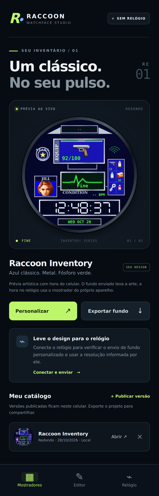

# WallpaperSmartWatch · Raccoon Studio 2.0

Aplicativo Android para criar versões do mostrador **Raccoon Inventory**, manter um catálogo local e enviar a arte por Bluetooth como **fundo de um mostrador personalizável** em relógios JieLi compatíveis.

**[Baixar o APK 2.0.0](https://github.com/perabru/WallpaperSmartWatch/raw/refs/heads/main/downloads/RaccoonStudio-2.0.0.apk)** · [Como a comunicação foi investigada](docs/INVESTIGACAO.md) · [Verificação da versão](docs/VALIDACAO.md)

> O envio Bluetooth está implementado com o SDK oficial JieLi. A compatibilidade da unidade identificada comercialmente como “Watch 8 Ultra” ainda precisa ser confirmada conectando o relógio. Não houve teste físico de autenticação ou transferência durante o desenvolvimento. O aplicativo só libera o envio após as verificações de protocolo e capacidades do aparelho conectado.



A imagem acima é uma prévia no celular. A hora e os elementos dinâmicos no relógio seguem o mostrador de fotos que o firmware disponibiliza. O inventário, o retrato e a linha “Fine” são arte; o aplicativo não apresenta uma frequência cardíaca fictícia como leitura de sensor.

## Instalar e usar

1. Baixe o APK pelo link acima no celular Android e abra o arquivo. Se o Android solicitar, autorize a instalação por esse navegador ou gerenciador de arquivos. Requer Android 8.0 ou posterior.
2. No MActive Pro ou no relógio, selecione um mostrador que aceite **foto/fundo personalizado**. Essa é a base que desenhará a hora e a data.
3. Desconecte temporariamente o relógio do MActive Pro para liberar a conexão. Mantenha-o perto do celular.
4. No Raccoon Studio, abra **Personalizar**, escolha nome, formato e cor. **Publicar no meu catálogo** guarda uma versão neste celular. Projetos JSON podem ser exportados e importados para compartilhar o design.
5. Abra **Relógio → Buscar relógios**, autorize os dispositivos próximos e conecte ao dispositivo de dados do relógio. O canal Bluetooth de chamadas pode ter outro nome e não serve para esse envio. No Android 11 ou anterior, a busca BLE também exige a permissão e o serviço de Localização; o app não consulta sua posição.
6. Aguarde a verificação da conexão. Quando aparecer **COMPATÍVEL**, toque em **Enviar fundo para o relógio**. A imagem será preparada na resolução informada pelo dispositivo.
7. Mantenha o app aberto até **APLICADO**. O progresso representa callbacks da operação real. A conclusão exige transferência, ativação e consulta de confirmação do vínculo entre o mostrador e o arquivo de fundo.

Se o envio não for liberado, use **Salvar diagnóstico Bluetooth**. O JSON permite identificar perfil, firmware, capacidades e falha da sessão. Ele inclui o identificador Bluetooth do aparelho selecionado e só sai do celular quando você escolhe exportá-lo e compartilhá-lo.

A versão em `downloads/` é um APK de desenvolvimento assinado, para instalação direta. Ela mantém o identificador `br.com.perabru.raccoonstudio` e a chave de assinatura usada na versão 1.0.0 preparada neste projeto. A chave privada não faz parte do repositório. Builds próprios e de CI têm sua própria chave de debug e podem não atualizar uma instalação assinada por outra chave.

## O que esta versão faz

| Recurso | Comportamento |
| --- | --- |
| Editor | Mostrador de inventário com retrato, painéis, cor dos indicadores, formato redondo ou retangular e prévia da hora |
| Catálogo | Até 32 versões locais; abrir, editar e remover versões; exportar e importar projetos JSON |
| PNG | Exportação do fundo, com os campos de hora e data vazios para serem desenhados pelo relógio |
| Bluetooth | Busca real, conexão escolhida pelo usuário, descoberta GATT, leitura de identificação e bateria quando expostas |
| Compatibilidade | Perfil GATT JieLi, autenticação oficial, inicialização RCSP, sistema de arquivos, chipset, dimensões e configuração |
| Preparação | Conversor oficial escolhido pelo tipo de chip; tamanho e máscara fornecidos pelo dispositivo |
| Instalação | Validação do mostrador atual, criação/substituição do fundo, progresso, cancelamento e confirmação após ativação |
| Recuperação de falhas | Timeouts, invalidação de callbacks antigos e reconexão obrigatória quando o estado da operação é incerto |
| Privacidade | Interface e catálogo locais; APK sem permissão de Internet; seleção de arquivos pelo seletor do Android |

“Publicar” no catálogo significa guardar uma versão no aplicativo. A loja interna do MActive Pro é um serviço de terceiros; não foi encontrada uma API pública para publicar nessa loja.

## Compatibilidade e limites do mostrador

A investigação encontrou a biblioteca `libjl_bmp_convert.so` **idêntica byte a byte** no APK MActivePro examinado e no SDK público da JieLi. Essa evidência justifica o adaptador implementado, mas não identifica automaticamente todos os relógios atendidos pelo MActivePro. As fotos confirmam tela circular; o anúncio não forneceu especificações acessíveis que permitissem fixar chip ou resolução.

O adaptador implementado exige:

- Serviço BLE `AE00`, característica de escrita `AE01`, notificações/indicações `AE02`, propriedades e CCCD compatíveis.
- Autenticação padrão `RcspAuth`, inicialização RCSP e inicialização do sistema de arquivos bem-sucedidas.
- Capacidade de transferência para a memória de mostradores e firmware fora de modo obrigatório de atualização/recuperação.
- `sdkType` 8, 9 ou 13, correspondentes às famílias de relógios 695X, 701X e 707N do SDK utilizado.
- Resolução anunciada entre 64 e 1024 pixels por eixo, e configuração de mostradores válida. O caso legado 695X sem suporte anunciado à consulta de configuração usa seu formato documentado.
- Mostrador ativo que responda à consulta de fundo personalizado, com nome/caminho reconhecido pelo exemplo oficial.

UUIDs ou nomes de Bluetooth isolados não habilitam a instalação. Perfis diferentes continuam disponíveis para diagnóstico. Uma autenticação recusada encerra a sessão; o aplicativo não tenta ignorá-la. O SDK pode sincronizar a hora do celular durante o handshake quando o dispositivo anuncia RTC.

**O modo implementado instala um fundo.** A posição, a fonte da hora, a data e os sensores continuam sob controle do mostrador do relógio. Alterar segundos, idioma e formato de hora no editor altera a prévia do celular; não programa livremente esses elementos no firmware. Não foi localizada uma API pública suficiente para compilar um mostrador dinâmico arbitrário para essa unidade. Isso está detalhado em [INVESTIGACAO.md](docs/INVESTIGACAO.md), com fontes e hashes reproduzíveis.

Ao substituir o fundo de um mostrador existente, um cancelamento ou desconexão não equivale a restauração da imagem anterior. Se a operação terminar sem confirmação, confira o relógio e reconecte antes de repetir.

## Compilar

### Android Studio / Gradle

Requisitos: JDK 17, Android SDK Platform 35, Build-Tools 35.0.0 e Python 3 para obter as bibliotecas fixadas.

```sh
python3 tools/fetch-dependencies.py
./gradlew :app:assembleDebug
```

No Windows, use `py tools/fetch-dependencies.py` e `gradlew.bat :app:assembleDebug`.

Abra a raiz do repositório no Android Studio. Configure o SDK pelo IDE ou por `ANDROID_HOME` / `ANDROID_SDK_ROOT`. O wrapper fixa Gradle 8.9 por SHA-256; o Android Gradle Plugin é 8.7.3. O Gradle verifica o tamanho e o hash de todos os AAR/JAR antes da compilação.

### Compilação direta com o SDK Android

O caminho usado para gerar o APK disponibilizado também funciona sem baixar o Gradle:

```sh
export JAVA_HOME=/caminho/do/jdk-17
export ANDROID_SDK_ROOT=/caminho/do/android-sdk
python3 tools/fetch-dependencies.py
bash build.sh
```

Resultado: `build/RaccoonStudio-debug.apk`.

O script extrai somente classes e bibliotecas nativas das dependências fixadas, compila Java e DEX, empacota os assets, alinha o APK e verifica a assinatura v2/v3. Os 20 binários nativos das quatro ABIs são mantidos sem alteração, sem compressão e com alinhamento ZIP e ELF de 16 KiB. As remoções de permissões do manifesto também são aplicadas no caminho de compilação direta.

A assinatura é criada fora da árvore do projeto, em `../toolchain/signing`, ou no diretório indicado por `RACCOON_SIGNING_DIR`. Não coloque a chave privada no Git. `RACCOON_VERSION_CODE` e `RACCOON_VERSION_NAME` permitem definir a versão no build direto.

### Dependências reproduzíveis

`dependencies.lock.json` fixa URLs, tamanhos e SHA-256. O SDK JieLi usa o commit `ba19b04e286dd116a4e8bae1779878404c1dad04` do repositório oficial. Os binários em `app/libs/` são obtidos pelo script e não são versionados.

```sh
python3 tools/fetch-dependencies.py --check
```

Esse comando verifica o cache sem rede. O script rejeita conteúdo inesperado antes de instalá-lo. Créditos e licenças estão em [THIRD_PARTY_NOTICES.md](THIRD_PARTY_NOTICES.md), `licenses/` e na tela **Licenças e créditos** do aplicativo.

## Verificar mudanças

```sh
bash build.sh
bash tools/test-policies.sh
npm ci --ignore-scripts
npx playwright install chromium
npm test
```

Os testes de políticas verificam dimensões, seleção do conversor, normalização de caminhos e nomes de fundo aceitos. O Playwright verifica editor, persistência, importação/exportação, tamanhos da imagem, estados de compatibilidade, prevenção de duplicatas, progresso, cancelamento e conclusão. As entradas de Bluetooth nesse teste são identificadas como **TEST ONLY**. Elas verificam a interface e não representam um relógio conectado.

O workflow [Android e interface](.github/workflows/android.yml) gera um APK e artefatos de verificação em pushes para `main`, pull requests e execução manual. As ações utilizadas e as dependências de teste estão fixadas. O relatório desta entrega está em [docs/VALIDACAO.md](docs/VALIDACAO.md).

## Organização do código

- `MainActivity.java`: WebView local, permissões Android, ponte com o editor e importação/exportação pelo seletor do sistema.
- `BleController.java`: busca, conexão, diagnóstico padrão, ciclo de vida do GATT e relatório da sessão.
- `JieliSession.java`: perfil BLE, fila de escritas, MTU, autenticação e verificação de capacidades com o SDK oficial.
- `JieliWatchfaceService.java`: consulta do mostrador, conversão, transferência, cancelamento e confirmação do fundo aplicado.
- `app/src/main/assets/`: interface em português, renderer do design e avisos de terceiros.
- `examples/`: projeto editável e imagens do mostrador.
- `docs/`: investigação, evidências e verificação da entrega.

O projeto usa arte de fã inspirada na referência fornecida pelo proprietário. A origem do retrato está em `ASSET_PROMPTS.txt`. Marcas e personagens pertencem aos respectivos titulares.
